<!-- Kaif Khan | Royal profile README. Keep the /assets folder next to this file. -->

  

  

<i>CSE undergraduate from Hyderabad building at the crossroads of AI, software engineering and interactive 3D. I turn ambitious ideas into working products and sharpen my fundamentals so they hold up.</i>

 

  
  

<i>Learning in public. Some of these are areas of active exploration, not production-level mastery yet.</i>

 

  
  

 

  
  
    
  <a href="https://github.com/achiever7182-commits"><b>GITHUB</b></a> &nbsp;◆&nbsp; <a href="https://leetcode.com/"><b>LEETCODE</b></a>

 

  
   
  
  
    
  

 

  
  

 

  
  

 

  
   
  <a href="mailto:achiever7182@gmail.com"><b>achiever7182@gmail.com</b></a> &nbsp;◆&nbsp; <a href="https://github.com/achiever7182-commits"><b>github.com/achiever7182-commits</b></a>
    
  

